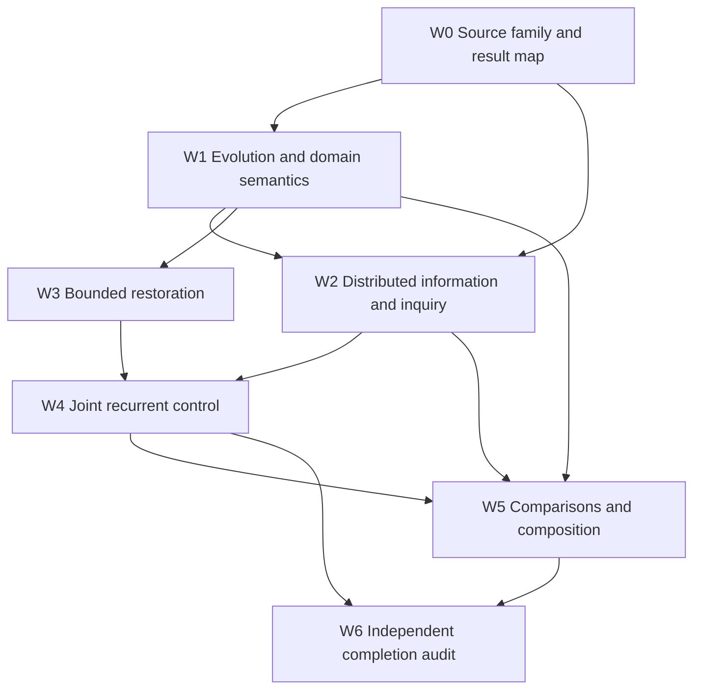

# Remaining Byzantine control research program

Status: audit-derived proposed research program under [DOWNSTREAM-CONTRACT](DOWNSTREAM-CONTRACT.md) and [FAULT-COVERAGE](FAULT-COVERAGE.md), following [REVISED-AUDIT](REVISED-AUDIT.md), with the applied premise decisions in [ASSUMPTION-REVIEW](ASSUMPTION-REVIEW.md). This document derives remaining work and its completion tests; it does not create a persistent Goal, claim that the remaining theorems exist, or accept the theory on the user's behalf. The existing science snapshot is bcf7c9837a2f4ac9b55f3e13a6e0a550e6d6cc41. The original audit used contract/taxonomy snapshot 37cc72365152b74591196ec86f3f5230980b7974; the current program additionally consumes the subsequently incorporated assumption-admissibility test.

## Objective and retained foundation

Complete the revised theory of adversarially fault-tolerant distributed control, with genuinely complementary local information, independent hostile effects, compromised decision/enforcement mechanisms, consequential intervention constraints, actual service, and bounded evolution of compromise. The downstream infrastructure setting tests adequacy; it does not create a general programming, governance, or universal-synthesis project.

Retain the checked static execution core, history/locality laws, robust evidence logic, source adapters, finite supplied-envelope synthesis, constructive relational gluing, BFT/quorum specialization, independent-effect braking, physical boundaries, and static-fault handover. Reuse requires matching hypotheses and source interpretation. Rebuilding them for cosmetic uniformity would waste effort. Reusing their completion labels, useful-observation premises or static fault support as if they solved the new obligations would fail the contract.

The central new result is an assembled family, not a pile of fresh examples. Its information is constructed from primitive observations and actual exchanges/probes; the same joint fault scenario governs inference, commands, effects and transition of capabilities; resources and time continue during investigation and repair. The main proof must not receive a useful estimator, trustworthy readiness, clean recovery, or compatible global action as unexplained services.

## W0 Pin the common result family and reuse map

Purpose: make theorem selection answerable to the contract before expensive construction. This is a bounded formulation task inside the program, not permission to renegotiate away difficult obligations.

Describe the primitive source family, initial information family, mission, observation/effect interfaces, actual ownership/fault domains, timing, resource budgets, and permitted capability changes. Prefer a coupled resource-process or finite/quantized relational family with explicit source interpretation; a sampled realization may be added where its intersample law is justified. Methods and exact mathematical carriers are open. The chosen class must admit the following together: local measurements that are not individually decision-sufficient; actual information exchange or inquiry; uncertain independent effects; compromised decision-bearing executors; simultaneous consequential evidence and enforcement faults; shared consequences or resources; nonzero time; actual service; and a meaningful change of compromised support and restoration of consumed capacity/information.

Apply the contract's assumption-admissibility test before treating any of these premises as terminal. Instantiate the A01–A18 schemas in ASSUMPTION-REVIEW: proposition/role, supplier, who knows it when, what can alter it, dependent claims, material challenge, and evidence-backed disposition. Record the legitimate design data d and compatible models Θ(d), separately from runtime observations and analyst-only quantities. Fix the source mission/service meaning and queried initial information/capability family independently of the eventual successful policy. This does not require computing a maximal winning region before research; sufficient operating subsets can be derived afterward with their exact membership and coverage consequences.

The primitive class definition cannot be “systems with a useful estimator/winning policy.” Declare the material variations before searching for a successful controller: remove or delay an evidence path, change surviving influence, restrict an intervention, vary a shared resource, change a common fault dependency, and acquire/release a compromised component. Exact characterization of every value of every parameter is not imposed, but the promised design comparisons must have fixed answer modes rather than being weakened after a failed attempt.

Produce a result map assigning M01–M45's required modes to shared theorem/reduction targets and retained artifacts. Resolve C01–C10 triggers against source claims. A fixed known identity-domain map is permitted only as explicitly justified design data or a conditional subcase; unknown maps remain alternatives or an unresolved boundary, not hidden facts supplied to code generation. Deterministic policies, fixed normative rules and bounded primitive uncertainty remain possible scoped choices under the same admissibility test. They do not automatically activate C01/C02/C03/C05/C07/C08, but cannot excuse identity double counting, model error, compromised inference or authority-state transitions. Existing continuous claims retain C04's scope; any new physical continuous claim must activate and discharge its own C04 obligations. No asynchronous or indefinite mobile-renewal promise is added by naming a time-dependent scenario.

Acceptance test: an independent reviewer receives the motivation, contract and source class before the candidate controller and tries to satisfy the proposed result map using a trusted estimator, assumed safe action, local full-state threshold, hidden clock, or spare that never matters. Reject the result map if such a candidate could receive completion credit while leaving a required service unconstructed. A stronger oracle is permitted as an explicitly conditional comparison; the test concerns false credit for the original obligation, not the mathematical possibility of making a problem easier. W0 does not close any constructive BC obligation by itself.

The review must also attack exact model knowledge unavailable at design time, a mission/entry region selected around the controller, passive dynamics that make enforcement incidental, and mutually incompatible structural restrictions. A favorable assumption may survive as a useful restricted result, but cannot close its parent merely because a sensitivity example was supplied. Source-relevant parameter/structural comparisons and the joint positive burden remain required.

## W1 Extend the causal and fault-domain semantics

Produce an evolution-aware account separating current adversarial control, released-but-contaminated state, accumulated knowledge/credentials, pending physical effects, remaining resources and relevant identity/role state. Define what a compliant executor actually follows after its stored state has been altered, and how local initialization/restoration occurs. The old pure fold of local history cannot be assumed to reconstruct attacker-altered memory without an appropriate observation/reset interface.

Prove the existing static core is a valid specialization or conservatively embed it with an explicit preservation law. Derive conditions under which an ever-compromised union or vulnerability-window abstraction is sound and what useful guarantees it loses. Provide an actual retained-secret/support-change obstruction to instantaneous-count reasoning, and preserve local observability: the analyst's current fault/cure label is not supplied to the controller.

At the same interface, derive the map from reported identities, roles, source paths and shared owners to actual fault/capability domains. Include alias amplification and a common-cause witness; retain history when schema, calibration dependency, access or privileges change. Recipient infection or a hostile update must change future powers if the admitted source interface permits it. Provide a source-triggered propagation/escalation reduction into W3's evolution relation, preserving causal order, altered recipient memory/access, retained credentials/knowledge, pending effects, and support/rate/resource bounds. Establish preservation for the admitted bounded propagation regime and the limitation when it exceeds those bounds. Syntax plus a counterexample does not earn M42's transition/composition credit. A specialized exploit discovery project is not required.

Prove or update the applicability of fault/domain/capability premises after internal actions. An external corruption budget may remain a declared assumption, but a repair, transfer or inspection that creates extra exposure cannot be omitted to keep that budget true. Retain unresolved model/domain alternatives across local histories and policy selection. Where a stronger-information adversary is used as a conservative model, state the direction of the resulting guarantee; source impossibility requires a source-admissible adverse choice or a justified reflection.

Reuse S1/S4/S6/S7 from the audit. Outputs are a semantic extension or justified abstraction, static specialization theorem, domain/meaning-preservation maps, and focused countermodels. Independence checks attack hidden initialization, contaminated re-entry, invented fault-budget resets, and parser-to-planner escalation hidden behind arbitrary message values. This package provides common definitions for W2–W5; it is not the missing positive restoration result by itself.

## W2 Construct complementary distributed information and inquiry

Derive local information updates from primitive measurements, actual receipts and permitted inspection actions. Retain world and fault alternatives jointly; the initial coverage and subsequent update must account for independent unknown or faulty actuator inputs rather than relying on the old protected gate's committed schedule. Derive useful decision precision and availability before the actual intervention deadline, not only asymptotic convergence or true-state inclusion in an unusably large set.

When model uncertainty is consumed, select the installed policy from legitimate d and preserve one mechanism across Θ(d); giving a different compiled controller the true unresolved model is not distributed inference. Information acquired later may guide actual local choices through the modeled history, not by retroactively choosing the correct initial controller. Known-model components can be retained at their actual scope without pretending to solve that unknown-model obligation.

The collective guarantee must consume control-relevant distinctions unavailable in the relevant responders' primitive observations; the mechanism must acquire, communicate or compensate for them. A more-informed participant may exist if its compromise is covered and it is not an indispensable trusted information/decision root. Inference/coordination executors can be compromised, recipient views can differ, and common source dependencies are explicit. Timing uncertainty, nominal model alternatives, referents/units/schema and duplicate-source identities are mapped to the same fault-labelled interface. A bound on intact primitive observations is permitted; a useful secure-estimation service is not supplied as a primitive.

Include a substantive information-acquiring mechanism whose observations can be misleading or withheld and whose operation changes time, resources or the apparatus. Establish when the mechanism creates a useful control distinction, what it cannot establish, and what remains safe while evidence is pending. Actual calibration/pose/provenance distinctions from S2 and readiness logic from S6 can be reused. Nominal physical observation/inspection laws may remain supplied primitives. The construction owes actual local acquisition, attribution, receipt, combination and timing/effect/service arguments under their shared faults, not a derivation of sensing physics. A reliable stage upgrade that supplies the needed information without that acquisition mechanism does not discharge the burden.

For every deadline-consuming acquisition, validation or inference step, derive workload-dependent processing, storage and transport demands, including adversarially chosen inputs within the admitted envelope. Bound the queue/admission behavior and show that it fits the consumed response and resource budget while the world continues evolving. Computation may be expensive and the applicability region restricted; disclosing cost without establishing the claimed deadline is insufficient. Offline analysis cost is separate from runtime cost, but may not hide unavailable model selection.

Required outputs: a reusable distributed update/construction, finite-deadline action-sufficiency conditions, a parameterized positive information/control family, and source-valid ambiguity/latency/common-cause obstructions. Account for corrupted decision executors in the mechanism, not solely in a separate physical example. Independent checks use equal-history worlds requiring different responses, common calibrators behind different credentials, truthful inspection followed by mode change, and false-alarm costs. These results feed W4; they cannot close BC2 without that actual realization.

## W3 Construct bounded restoration under acquired compromise

Extend the substantive handover reasoning into the W1 evolution model. At least one admitted acquisition/release transition must materially affect a capability or information dependency used by W4. Current control, contaminated memory, previously learned keys, stale valid artifacts and delayed effects remain distinct. Restoration must result from actual local procedures and available surviving resources, not a clean-state acknowledgment or globally known cure flag.

Reuse S6's disjoint-slot survival, delayed overlap, false READY, key/executor distinction, and wrong-order failure. Re-establish evidence applicability after fault support changes; static persistence of an intact warm path no longer supplies that step. It may be possible to retain or replace compromised components conservatively rather than prove universal cleansing, but the positive result must actually restore the mission-consumed capacity under the stated bounded regime.

Required outputs: a uniform local mechanism with protection and service while restoration is pending at its stated scope, a quantified functional-restoration conclusion under explicit opportunity/progress conditions, an informative failing regime, and explicit current/cumulative/window/rate/resource assumptions. A successful trace or an eventually-clean premise does not prove restoration. W4 must discharge the resources and continued protection used during waiting and admitted failed attempts. State which transitions can safely repeat and what re-establishment would be required; no indefinite renewal follows without proof. Private clean-memory primitives or new crypto may be imported only at their actual declared role, without restoring an indispensable trusted global supplier. Supply opportunities may remain external; successful installation and evidential trust cannot.

Decompose each opportunity premise into primitive availability, duration/order, adversary restrictions and enabling information actually needed locally. Its predicate must not contain trustworthy readiness or restored capacity as already-achieved conditions. A mechanism can exploit an opportunity through repeated safe attempts without detecting its beginning; do not add an unnecessary omniscient window detector. Fixed rule semantics do not supply correct hidden factual triggers or current evidence. Prove operational interpretation, evidence applicability and the allowed effect where the mechanism consumes them.

Independent checks include sequential key harvesting, release with poisoned memory, compromise after true READY, restoration while old effects remain in flight, and false readiness followed by retirement of essential capacity. W3 and W2 must share the same state, evidence and fault interfaces; a restoration mechanism that depends on unavailable inference does not assemble.

## W4 Prove the integrated recurrent control construction

Replace the old individually sufficient scalar frontend with W2's actual mechanism in the W0 source family. Couple it to independently applied interventions and W3's consequential support/capability change. One joint model must retain faulty sensing, inference/decision executors, enforcement, communications and their shared causes, including simultaneous evidence/enforcement impairment. No protected global action gate or indispensable perfect estimator is permitted as the missing mechanism.

Construct the invariant/continuation family and its initial membership rather than merely supplying Q to an unchanged generic solver. Preserve actual service and response admissibility together with world safety. Include the time and resource cost of inquiry, delayed effects, loss of useful observation, overlap/repair load, and repeated bounded-rate provocations. Existing heat and queue arguments supply proof patterns; they do not magically account for a new finite reserve or a resource-consuming probe.

Derive Q and any sufficient operating subset relative to the source mission and queried initial family fixed in W0. A convenient nonempty subset cannot silently replace those requirements. Establish the supplied or constructed basis for entry and re-entry, retain excluded cases and actual service horizons, and distinguish claimed initialization mechanisms from stipulated source starting conditions. Challenge favorable passive stability, separable effects, loose collateral bounds and ample resources by source-relevant changes with the mission fixed; mandatory mechanisms must have actual causal or decision significance.

Close the potential assume–guarantee cycle explicitly: W2's safe inquiry and W3's safe restoration can consume the protective capacity W4 obtains from their outputs. State entry, exit and re-establishment conditions for those phases and prove an initialized simultaneous invariant or phase induction establishing them together. Prove that all retained assumptions have a nonempty jointly applicable regime with the defining interactions, and that shared time, spare capacity, energy, computation and communication liabilities remain feasible through the claimed runs. Separate module witnesses or pairwise compatibility do not suffice. W2/W3 may supply conditional component lemmas; neither may assume W4's final guarantee as an unexplained premise. The dependency diagram below is a work-product organization, not proof that the mechanisms are independent or already assemble.

The constructive theorem must cover a primitive parameterized class with meaningful coupling, not just independent copies. Expose structural conditions and quantitative margins that can be used to judge information-path, latency, surviving-influence, permission and resource variants. Verify each required interaction matters by a change in verdict, local choice, guarantee or consumed margin. A full hydrological deployment is not required; the source interpretation must preserve the specific physical/effect claims actually made, with a timed/inter-sample argument if C04 is activated.

Independent checks must include the cross-class probes in FAULT-COVERAGE. Persistent attacks within the admitted envelope do not eventually stop by assumption. If resources cannot sustain the original mission, report the actual feasibility boundary; do not redefine service or count a finite horizon as indefinite. W4 is the central positive result; its absence blocks program completion even if W1–W3 are individually useful.

## W5 Derive reusable comparisons, composition and assumption exchange

Use the common W2–W4 family to establish the promised same-mission information/influence/time/resource/admissibility comparisons. Provide a locally implementable weaker coordination object than value agreement where sufficient, or a structural obstruction where that weakening fails. A protocol using agreement does not by itself prove the mission requires agreement. Old S2 permissive-control comparisons remain conditional on their gate; S5's limiter exchange supplies a sound pattern but not the new sensing exchange.

Derive useful compatibility interfaces retaining common faults, local-view consistency, resource liabilities, evidence validity and evolution. Apply S4 join/assembly results where their hypotheses fit; otherwise repair the interface explicitly. A complete global product may be a correct fallback, but cannot be the only evidence that the new modules compose. Source-field and local-strategy preservation must survive the changes in W1, particularly contaminated memory and absence/timing.

Perform an actual assumption exchange for the missing evidence service: identify the older useful-information premise, an admitted failure without it, the W2 mechanism supplying what is needed, and the residual primitive laws. Use a common source mission, initial-state comparison, physical-time basis and joint fault/resource accounting, while explicitly recording the mechanism/interface change and its actual costs/effects. Same-mission comparison does not require identical trace sets or erase the new probes' duration and influence. Preserve the unchanged source laws on common operations and justify translations for added/refined operations. This directly tests whether the new work discharges the retrospective's principal displaced burden.

Outputs are parameterized comparison/obstruction results, constructive composition/refinement laws with dischargeable premises, and source applications. Existing BFT/quorum specialization can be reused; transport it only where the new claims consume it. No new universal-synthesis, language-design or governance duty follows.

Revisit the A01–A18 decisions with the actual theorem restrictions. Record which assumptions were constructed away, handled as uncertainty, retained as legitimate primitive boundaries, or support only a restricted component. Challenges must establish a source-relevant consequence and preserve the parent task; they are not a quota of counterexamples or permission to close every difficulty with an artificial impossible case. A justified restricted theorem can be retained without closing the broader obligation it fails to answer.

## W6 Close the coverage ledger and independently verify the assembly

Map each mandatory family/mode to actual statements, source mechanisms, witnesses and scope; one theorem may discharge several families. Each P mapping must admit consequential adverse behavior or the relevant harmful compliant composition. Each B/A mapping must be an actual informative boundary/validity argument. Taxonomy labels and a generic arbitrary-output type do not establish coverage of changed powers, time, state or source meaning.

Resolve active conditional obligations and retain the exclusion boundaries. Check the scope of reused statements before broadening it. Extend the established source-bound verification infrastructure only for changed/new artifacts. Preserve independent mathematical checking, executable reproduction, source interpretation and overall adequacy as different evidence. Inspect both the actual fixed final sources and the target from which their obligations were derived; do not audit only the new result ledger.

Completion requires all BC1–BC7 obligations and activated coverage duties, the combined positive result, actual compatibility/realization, and independent review against the fixed contract. A meaningful obstruction answers its stated question; it does not replace the separate positive requirements. No milestone closes the whole program. The scope and type of any residual remain visible and keep its required parent incomplete.

At closure, audit every load-bearing assumption used by the final package, including newly introduced ones, against the contract's admissibility test and the joint positive construction. Confirm knowledge/time provenance, unchanged mission/query coverage, endogenous bound maintenance, causal resource feasibility and honest progress predicates. The A01–A18 ledger is an initial inventory, not a whitelist allowing later unnamed premises. Disclosure or an accurate restricted theorem cannot substitute for discharging a mandatory internal service.

## Dependencies and autonomous branching

Related-work checking and small source probes can run while W0/W1 settle interfaces. Concurrent writers need separate owned worktrees and versioned common definitions under EXECUTION.md. The existing integration checkout remains unchanged until explicit integration work is undertaken; this formulation branch is not the latest science branch.

Before executing a new research Goal, assemble a clean research checkout containing the science snapshot bcf7c98 and these current contract/taxonomy/audit/program artifacts through explicit reviewed integration. Do not start from the older worker copy merely because it is the current formulation directory, or overwrite the latest integration TODO with inherited worker status. Keep the old verification record recoverable at its source commit; adding or changing manifest-bound documents means it is historical evidence until a new matching reproduction is made. No worktree, merge or reproduction is initiated by this planning document.

Before substantial original work, check the closest primary results and their exact local adapter burdens. Prefer a valid import over unnecessary reinvention. If an observer gives only asymptotic convergence, seek a finite-time envelope or change the mechanism rather than pretend the deadline is met. If a recovery scheme relies on an excluded trusted root, construct or import a suitable local replacement and retain its actual premises. If a selected family cannot meet the defining interactions, revise the candidate family with the contract preserved; do not weaken the parent requirement to match the proof.

Update the effort forecast after the W0 family/import review, the first information-to-control proof, and the first bounded evolution/restoration proof. These are discriminating research milestones, not user-imposed time or token budgets. A failed approach is evidence for a different method or another unblocked obligation. Overall impossibility or missing authority must be demonstrated at the required scope before stopping as blocked.

## Prior-art routes requiring renewed checking

The following are candidates for reuse, not claimed solutions to this program. Primary statements/assumptions were checked on 2026-10-23; no fresh import proof or exhaustive literature search is claimed.

- [✓] [Mitra and Sundaram, arXiv:1802.09651v2](https://arxiv.org/html/1802.09651v2), system/attack model and distributed-observer formulation: complementary local linear measurements and graph-based resilience are directly relevant. The autonomous LTI/asymptotic setting does not establish finite-deadline control with independent unknown actuation. Use it to test candidate structural conditions, not as a substitute for W2/W4.
- [✓] [Niazi et al., arXiv:2309.05075v4](https://arxiv.org/html/2309.05075v4), model, Assumption 1 and Theorems 1–2: known input, bounded noise, initial-set inclusion and redundant observability support set inclusion under per-time sensor attacks. This version deserves renewed comparison with the older deposited manuscript cited in the package; the current statement does not simply reuse that source's global bounded-state premise. Its assembled measurement sets do not by themselves provide Byzantine communication, faulty inference executors, useful finite-deadline control precision, or W3's retained-key restoration. Proof details and a local adapter must be checked before import.
- [✓] [Castro and Liskov, Proactive Recovery](https://people.cs.umass.edu/~arun/cs677/reading/PBFT2.pdf), introduction and system assumptions: vulnerability windows, retained authentication material and freshness identify real recurrence burdens. The protected cryptographic/recovery substrate and digital replication model cannot be transferred as a gate-free physical-control result. It is a comparison and possible component source, not W3 already solved.

Other maintained source assessments remain historically scoped [~] unless rechecked for the selected new target. These routes mean original invention is not necessarily required for every missing ingredient. Their assumption compatibility is the expensive unresolved work.

## Relative effort estimate

For this estimate, one prior-package equivalent means the substantive construction, integration and independent checking represented by the complete existing science package through bcf7c98: the protected-interface foundations, gate-free enforcement, and subsequent structural/core/handover integration. It is not a measured labor-hour, token count, number of declarations, or percentage of taxonomy rows. The estimate excludes this formulation/audit writing as if it were equivalent scientific progress.

My planning judgment is **roughly another one to two prior-package equivalents** to discharge the revised target, assuming existing results are reused and a workable structural family and import path can be found. This is a broad work-content estimate, not a statistically calibrated interval or guarantee of theorem discovery. It describes substantial further research, not the last ten or twenty percent of a nearly completed result.

| Remaining block | Relative burden and basis |
|---|---|
| W0 plus domain/result mapping | Small to moderate compared with the old package; mostly source refinement and deliberate target selection, but cannot be skipped. |
| W1 semantic evolution | Moderate, potentially major if static compliance assumptions pervade proofs; old source/history/assembly lemmas provide a real base. |
| W2 complementary inference and fallible inquiry | Major. It changes the central information architecture and likely exceeds the old evidence strand; existing source lemmas do not supply its useful information. |
| W3 consequential restoration | Major. Comparable to or larger than the old enactment mechanism because current support, contamination and learned authority must diverge safely. |
| W4–W5 coupled control, comparisons and composition | Major shared work, charged once. Reuses old physical/relational proofs but must establish their missing inputs and the new resource/evolution couplings. |
| W6 integration and independent checking | Substantial. The harness is reusable, but changed semantics and source maps need new adversarial checks; repeating unchanged checks alone does not reduce the missing research. |

Favorable case: strong existing imports align and the new mechanisms fit the retained interfaces, so the additional work could be somewhat less than one prior package. Central case: W2 and W3 each require a significant construction followed by a comparable combined proof/verification cycle, giving the one-to-two range. Difficult case: information sufficiency or safe re-entry forces a new source family/interface and several attempts, taking two to three or more prior-package equivalents. Research has no honest guaranteed upper bound here. Shared work between W2/W3/W4 must not be counted repeatedly.

The main uncertainty is whether the required combined family admits useful constructive conditions under the intended local information and changing faults. The next useful forecast update comes from those mechanisms, not from expanding the taxonomy, polishing old proofs, or increasing enumeration counts. No arbitrary budget or stopping permission is introduced by this estimate.

## Recommendation on target maturity

The targets are sufficiently refined to begin this program responsibly. They now distinguish source assumptions from internal tolerance services, scoped results from whole-program completion, static from evolving compromise, and useful construction from semantic expressibility. The present audit actually rejects the earlier convenient closure, which is evidence that the new criteria discriminate.

They are not self-enforcing. The principal remaining interpretive risk is a chosen structural family that makes the hard information or resource dependencies incidental. W0's independent admission test and W6's direct source-to-contract audit address that risk without requiring the user to inspect all 45 families or solve theorem-selection details. The recommendation is to use this program as the next Goal's basis if continuation is requested, not to start another broad reformulation cycle or to declare the current science complete.
