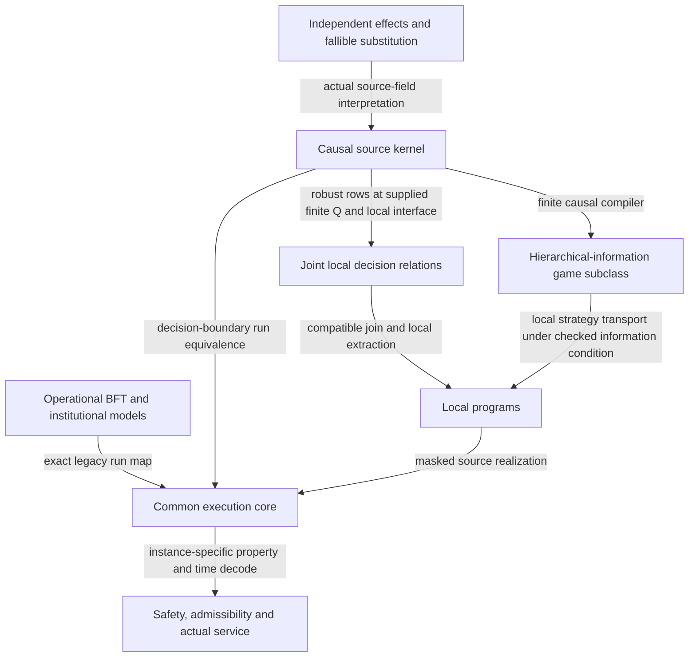

# Distributed invariant enforcement with fallible enforcement

Status: integrated synthesis for the full HANDOFF R1-R8 program, interpreted by MOTIVATING-PROBLEM. The fresh independent program audit supports completion subject to the matching source-bound aggregate execution record. This document assembles the results; the source-traced [full-program ledger](../FULL-PROGRAM.md) controls completion. Repository acceptance remains separate.

## The central result and its meaning

The theory treats Byzantine tolerance as a question about what a population can keep true of an evolving world, using only its members' available information and actual capabilities. Agreement is one possible intermediate mechanism. The success judgment is an admissible, nonblocking execution with the required service, including the consequences of hostile physical action and hostile enforcement.

The contribution is a related family of execution, feasibility, synthesis and realization results. It includes a general information-dependent characterization; explicit ways to construct compatible decentralized decisions; an effective subclass selected by information structure; a parameterized independently actuated control family; and a capability-substitution mechanism whose installers, controllers, keys and actuators can fail. The digital BFT, witnessed-evidence and institutional results are preserved through concrete execution and judgment maps. No claim of universal controllability or universal distributed synthesis follows.

The positive physical constructions do not put a trustworthy controller in front of every effect. Hostile motors continue choosing their own torque. Faulty brakes may engage without a compliant command, refuse a command or continue after nominal retirement. Different intact planners receive different reports. Their effects combine physically. Safety, service and stipulated response rules are proved together under one joint fault scenario.

The construction nevertheless assumes enough surviving observation and influence, bounded hostile force, declared delay, valid physical relations and persistent resources. Those are the feasibility conditions, not an eliminated trust burden. Removing every such restriction would make even elementary invariants impossible. The research result exposes which restrictions are consumed and provides admitted failures when particular resources are lost.

A modeled motion or output variable is not a validated hydraulic system. The community flood scenario specifies the kind of problem; the parametric control constructions answer that problem in declared model classes. They do not claim that a particular community's gates, property rights and drainage network have been engineered or politically authorized.

## One semantic core, with distinct kinds of fault

A context fixes the plant and model uncertainty, component interfaces and ownership, timing, available local information, initial scenarios, joint faults, prescribed-response rules and actual service mission. A state can include physical variables, queues, installation stages, messages, keys, institutional records, resources and relevant history. No datatype or application domain is built into the general execution model.

For each joint fault f, C(f) identifies policy executors that must follow their prescribed programs. It does not identify every intact component. A planner with a faulty sensor still owes its duties. A planner with a faulty actuator can issue a valid command whose effect is different. A stolen key can produce an accepted token without its uncompromised executor issuing anything. Role budgets are projections of the same f, including shared causes; counting the same failure separately in each component proof would be invalid.

One local policy family is selected before f and before the actual initial information scenario. Each actor uses only its own actual initial input and invocation history. The semantic target quantifies universally over every admitted causal hostile choice and environmental continuation. It requires execution existence as well as the mission. Deadlock and maximal finite failure receive explicit losing verdicts; removing an inconvenient transition is not a safety argument.

The mission has separate consumers: world safety, selected protected outcomes, actual delivery, and admissibility of prescribed and issued responses. Protected outcomes count regardless of who causes them. Correct-party conduct is indexed by C(f), because a compromised executor can intentionally disobey. This does not excuse the resulting physical damage: those effects remain under world-level constraints. A stronger mission forbidding every malicious act is unrealizable whenever the plant permits such an act before prevention. That is an obstruction to that mission, not permission to weaken it silently.

[CORE](CORE.md) constructs a decision-boundary normal form. Its world contains the actual source and mission state; local memory and current joint observations are retained separately. A normal edge performs one source physical interval, then prepares the next observations. It does not add an extra interval for observation, signing or analytical phases. The actual source joint observation relation is preserved rather than replaced by a product of projections.

The policy's total mathematical entries at absent or faulty invocations are unused values. They are erased before source commands, queues, memory updates, histories and conduct checks. The actual faulty commands and effects are generated by the source effect relation. Missing calls do not advance a local memory, although real time and service deadlines can still advance.

The checked initial-memory theorem requires the source initialization to be generated by fixed local functions mu_i on actual local initial inputs. Arbitrary analyst-chosen memory is not admitted as a local implementation. Subsequent memory is a fold over the actor's actual invoked observations; silent intervals disappear from that fold. Fault identity and global depth are not hidden controller inputs.

CoreBridge proves exact source steps and runs, legacy-model recovery, local-memory generation and nonblocking under its stated primitive totality conditions. The executable completion retains failed attempts, their completed local memory updates and silent terminal behavior. [APPLICATIONS](APPLICATIONS.md) gives the field interpretation for the actual enactment and shared-device kernels. These are encoding and model-level realization results; faithful physical calibration remains outside their proof boundary.

The assembly map is shown below. Its boxes are mathematical interfaces; runtime actors still receive only their own permitted inputs. Each arrow has the specific preservation obligation developed in the linked component.

## General feasibility: the information family is part of the state of the problem

Knowing the true physical state for analysis does not make it available to a controller. Likewise, separately finding a safe action in every possible world does not show that the actor can choose among those actions. The correct object retains an entire family of possible execution prefixes, including fault alternatives and the local histories they induce.

The clock-free continuation construction retains a prefix family K and a persistent partial local table Gamma. A key identifies an actor and its permitted local invocation history. An extension supplies commands on newly encountered keys while preserving every existing choice. The complete successor family contains every admitted hostile outcome and next joint observation. It does not let the analyst choose a different command in two worlds that the actor cannot distinguish.

For a finite horizon, the exact recurrence asks for a consistent table extension, nonblocking at every retained alternative and success of the complete successor family. Induction gives both directions: an admissible local strategy restricts to such extensions, and accepted extensions assemble into a strategy for the generated family. This is an exact characterization of the declared finite-prefix obligation, not a statement that pooled beliefs or independent local solutions suffice.

Unclocked.lean supplies the representation theorem behind this construction. Prescriptions selected at different global depths are representable by one local policy exactly when they agree at all compliant occurrences with equal supplied local views. Under the complete reachable-family condition, the representing policy has exactly the same reachable families; it does not introduce unexamined branches. Safety and nonblocking transport with them.

For infinite safety, a strategy is equivalent to an infinite compatible extension chain covering every generated finite prefix. With finite actor, initial-input, observation and command alphabets, tables on all syntactic bounded histories form a finitely branching tree. Safe tables at every depth then have an infinite branch by the retained checked tree lemma. The compatible union is one local strategy. This is a classical existence result; it does not give a finite-memory bound or decide arbitrary distributed synthesis. Infinite action alphabets can defeat compactness, as the retained finite-fuel obstruction shows.

Bounded service is included by actual service-age updates. Unbounded recurring or eventual service is not automatically prefix safety and needs a separate acceptance argument. The finite checker uses decreasing ranks on every service-free edge where required, not merely tests of bottom components. The hierarchical-information route below supports finite-state omega-regular missions under its own conditions.

Two elementary obstructions explain why the general characterization matters. If all honest intervention histories remain indistinguishable through the deadline while the worlds require disjoint admissible intervention transcripts, no local strategy can win both. The motivating packet's coupling argument also rules out probability-one success in the corresponding randomized setting; the implemented controllers here are deterministic. Independently, an unopposed hostile transition can force failure even with perfect state knowledge. Timely information and actual influence are different resources, and admissibility can make otherwise sufficient influence unusable.

## Constructive compatibility and the structural replacement for replica counts

[STRUCTURE](STRUCTURE.md) turns one important feasibility class into an explicit construction. Fix a finite source kernel, local observation/memory interfaces, local initializers and a supplied invariant envelope Q. A variable is one actor's command/next-memory choice at one local memory/observation pair. The same variable is reused across every world and fault scenario where that view occurs.

A predecision scenario contributes a relation containing exactly the tuples whose actual outcomes are nonempty, satisfy the joint edge mission and return to Q with correct service-age updates. Evidence restricts which scenarios an actor can distinguish. Permissions restrict which prescribed commands are admissible. Causal influence determines the actual successor relation. These are different operations on one constraint system, not three renamed voting thresholds.

The natural join of all scenario relations is nonempty exactly when one local table family preserves that supplied envelope at the selected interface and recurrence-certificate scope. A joined assignment constructs the local programs. Conversely a preserving program supplies joined rows. Initial validity is checked at actual initial nodes; arbitrary off-reachable Q states are not presumed valid initializations.

This exactness is for Q closure and the chosen interface. It does not assert that Q is maximal, that every winning history strategy fits the memory bound, or that a LOW/HIGH interface is complete for raw numeric reports. Those stronger judgments have separate quantifiers and are not purchased by a finite table search.

When relation scopes admit a running-intersection join tree, two semijoin passes and row extraction construct a global assignment or establish emptiness. The generic gluing theorem is mechanized. A checked tree decomposition may provide bags where raw scopes are cyclic. Its width is the real cost parameter. One bag containing everything is exact but supplies no decomposition speedup.

The shared-planner construction shows that this is more than a collection of independent devices. One local planner controls a path on each of two devices; its single command must be equal on both. Its pair signal and the four other planners' private target signals are actual source interfaces. The two component relations share the same two decision variables, and joining them produces one five-planner program. Heterogeneous force modes can change every interval without becoming public state.

The family extends to any finite number of devices with one shared planner and two private planners per device. Each bag retains six variables, while the global policy grows with the population. Every source observation and effect projects into the corresponding component under the same global fault. The private surviving paths preserve the local envelope even when the shared signal is weak. Aggregate service comes from actual distinct output paths; thermal resources are either summed under a shared budget or explicitly separate.

A concrete incompatibility variant gives the shared planner opposing duties at the same local observation. Each component separately has valid policies; their shared projections are disjoint, the join is empty, and either physical command violates one duty. Thus local correctness alone is demonstrably insufficient.

Resource supports and blockers are derived from the actual joined rows under an explicitly monotone permission order. More permission means the same physical effects and faults with more available compliant programs; it does not mean adding uncontrolled hostile devices. The ordinary three-brake rows need any two threshold permissions. The weak shared port needs its two private planner permissions. Faulty ON commands and uncommanded effects remain even when a compliant program lacks permission.

The ordinary signing-quorum specialization additionally needs guarded issuance, actual authenticated receipt, correct-path intersection, current scope and realized state transitions. A set-intersection lemma alone cannot establish control, publication or service. [ALIGNMENT](ALIGNMENT.md) makes the source/quorum connection operational while preserving effective signing faults versus compliant executors. Its independent review passed after repairing the digital failed-command continuation; failed profiles now remain typed, observable as absent invocations, and non-serving through the common core.

## Evidence, certificates and institutional constraints

The retained [EVIDENCE](../research/EVIDENCE.md) theory separates an external target, a sensor's pose and conditions, internal registration, a report and its delivery. Observing identical pose, target and report need not identify an internal reading or calibration. An inconsistency can establish that some premise failed without identifying which sensor, witness or model is faulty.

General source constraints retain pairs of world and fault hypothesis. Honest-path constraints establish coverage of the actual alternative. Decision certificates quantify over the retained alternatives using the actual effect and permission relations. Exact state reconstruction or fault attribution is unnecessary when all alternatives share a safe admissible response. Conversely a state-only envelope is insufficient when different fault identities change which interventions are effective or permitted.

The robust threshold frontend gives a constructive inference example. More than half the declared source positions lie within the error envelope, so a local median does too. Shared calibration or delivery failures count against every affected position; duplicate messages do not create independent evidence. This frontend proves the selected threshold implication. It does not license arbitrary deductions about the target or identify the bad source.

Passive information refinement can preserve an old strategy when the old local view is a local projection and timing/effects are unchanged. Active inspection is an action: it can consume time, affect resources or change the target, so the old continuation proof must include those effects. Additional information after the intervention deadline cannot repair an earlier failure. Reliable local broadcast, added evidence and physical containment are different mechanisms.

The institutional model retains permission, duty, power, credential access, recognized status and actual ability as different relations. A powered act can be forbidden; an unauthorized physical act can still have an effect; immunity from a specified institutional power is not mechanical tamper resistance. History monitors retain triggers, deadlines, beneficiaries and exceptions where those facts matter. Fixed institutional rules are inputs to the theorem, not conclusions about legitimate governance.

Public evidence has an operational generator, a recipient's acceptance predicate, a fact and a soundness theorem under explicit fault assumptions. Attainable artifacts prevent vacuous soundness. A cryptographically valid token can come from a compromised key without the executor personally approving it. Historical acceptance and current eligibility are distinct, and scope validation precedes deduplication. The enactment construction makes these distinctions affect actual release behavior and physical safety.

## Independent physical enforcement and its quantitative boundaries

The retained physical theorem allows heterogeneous service devices j with actual discrete motion v_j'=max(0,(1-c_j)v_j+tau_j-B_j), where B_j is the sum of bounded actual engagements. A normal motor supplies tau_j^0; a compromised one chooses any admitted torque up to T_j and can withhold output. At most f_j of m_j planner/effect paths are affected, with unknown identities. Intact paths retain actual FIFO delay at most D_j and the specified startup queues.

Local threshold decisions use their own noisy source vectors. A sufficient regime requires enough normal torque to preserve L_j under maximal braking, enough surviving force against maximum rogue drive, and enough room below V_j for growth after the most recent low sample through the response delay. In the maintained theorem these are

tau_j^0 >= c_j L_j + b_j m_j,
b_j(m_j-f_j) >= T_j-c_j V_j,
A_(j,D_j+1)(q_j+epsilon_j) <= V_j,

with the stated parameter domains and A_(j,n)(x)=(1-c_j)^n x+(T_j/c_j)(1-(1-c_j)^n). The factive response rule also requires q_j-epsilon_j>=r_j>0.

The thermal condition sums the actual maximum loads against available dissipation. Normal motor/output chains supply actual service; with at most p compromised chains, the guaranteed floor is the minimum intact-output sum over all allowed faulty motor sets. One controller preserves these obligations on the same run. Always braking can violate the current-response rule even where physical safety would survive; knowledge is therefore a consumed resource.

These inequalities are sufficient, not necessary in every plant. Their domains vary population, error, delay, force, service and resource allocation. The quantized executable is a declared specialization with a proved downward-quantizer condition, not an uncontrolled approximation to continuous mechanics. Independent finite checks include hostile effects, different local labels and actual deliveries.

The existing failures distinguish missing timely information, insufficient force, excessive enforcer influence, unauthorized intervention and shared-resource overcommitment. A failed sufficient inequality alone proves no impossibility. The specific legal counterstrategies and indistinguishable histories support the negative claims.

[EXCHANGE](EXCHANGE.md) supplies the missing same-plant trust comparison. Under a baseline limiter mapping requested torque six to effective torque five, an OFF policy preserves the fixed speed/heat/service mission. Removing the limiter gives the admitted trace 4,8,10,11 under that policy. The decentralized threshold policy restores the unchanged mission in the enlarged effect context. The replacement contains no execution gate. It trades the limiter premise for explicitly surviving local sensing/braking paths and their timing/force margins. This is a policy/design comparison from the declared initial family, not a blanket permission for arbitrary runtime hardware or policy swaps. The enactment construction below supplies the separate temporal handover result.

## Changing capabilities without assuming clean installation

[ENACTMENT](ENACTMENT.md) constructs safe substitution with faulty installers, planners, actuators and signing paths. Old paths remain active while a spare is installed and warmed. A scoped certificate can authorize release, but the proof never equates a readiness artifact with infallible hardware.

For each replacement slot, either an old or spare path supplies the required delayed effect, or that slot's failure consumes the joint fault budget. Summing disjoint slots yields at least m-f surviving engagements, while charging all m+k potentially simultaneous effects to service and heat. This is a general disjoint-slot bound, with an actual four-chain protocol and a second parameter regime checked separately.

The key invariant is conditional on the actual same f: accepted READY implies an affected spare chain or a persistent warm command-following interface; retirement implies an affected old chain or the required readiness history. Operational signing and installation transitions construct and preserve these implications. Queues survive installation. A compromised actuator can continue acting even when a mode label says unavailable or retired.

Two scoped authority shares guarantee an uncompromised guarded signing path under the executor/key union bound. They do not prove that two human or process principals personally issued approvals. A concrete key-only trace keeps all executors compliant while an attacker supplies a token through a stolen key. Current-command duties remain attached to the real issued commands.

Safety and actual service persist even when installation or authorization is indefinitely withheld. Functional replacement completion additionally requires intact relevant effect paths and eventual installation/message progress. Certificate or latch completion is weaker. The wrong-order controller releases too early and admits a physical 7,10,11 failure from ordinary initialization. The positive construction changes that outcome by retaining usable overlap.

The older perfect-isolation and clean-key recovery theorem remains a different conditional protocol. Its assumptions are neither imported into this mechanism nor declared discharged by renaming a registrar. Static fault membership and persistent intact capability are still premises. Mobile corruption, repeated cleansing, arbitrary destruction and political revision of the rules need further models; no theorem here secretly supplies them.

## Digital recovery, other representations and effective synthesis

The recovered digital baseline is actual signed synchronous broadcast and its repeated ledger, not merely an abstract quorum inequality. Correct forwarding and decision guards establish agreement, validity and fixed-round termination. Terminal attestations give certificate knowledge because the operational protocol already establishes the relevant decision fact. Removing forwarding admits the conflicting-certificate counterexample.

The event-product/history correspondence preserves tracked facts and local indistinguishability through the selected event sequences. It supports possession and nested epistemic queries without treating a signed statement as a truthful public announcement. Historical finality and future conflict exclusion have continuation semantics. Receipt does not imply universal possession, and certificate validity does not establish every signer's exact current state.

The same execution core has a faithful legacy embedding for these digital and institutional models. Its converse proves every admitted normalized legacy run projects to an original run. Their local-view equalities and tracked atoms are preserved. This retains their actual conclusions while retaining their original timing, cryptographic and physical assumptions.

The independently checked [hierarchical-information contribution](HIERARCHY.md) supplies an effective unbounded-horizon route for finite synchronous arenas after the full unknown-fault expansion. Byzantine program slots are masked; Nature retains actual faults, commands and effects. Finite monitors encode the selected safety/service mission. Hierarchy is checked on every arena history before fixing a winning policy, not separately for a known fault or only on one controller's reachable graph.

The source theorem gives finite-state strategy construction where dynamic hierarchical information holds. The concrete public-report brake specialization and its full-arena certificate witness nonempty applicability; its public delivery is an explicit stronger communication context, not a gate on physical actions. Private arbitrary information structures are not asserted hierarchical. Missing invocations are not made into observable synchronous ticks to force the import.

Across these maps, epistemic equivalence, safety refinement and strategic realization are distinct judgments. A statewise existential action can depend on information the actor lacks. A valid controller lift must be computed from that actor's actual local history and must cover every adverse continuation. Stuttering must preserve the relevant observation and service clock. The new boundary adapter, clock-free theorem and explicit source applications discharge these obligations for the constructed family.

## Scope of completion and evidence

This synthesis addresses the full research program by giving results at different justified scopes and proving how they connect: general semantic characterization; constructive supplied-envelope synthesis; a verified effective information subclass; parameterized physical enforcement; operational capability substitution; recovered digital evidence and institutional distinctions; and explicit assumption exchanges and obstructions. Neither a finite example nor a bibliography replaces the general obligations.

The evidence grades remain distinct. Lean checks the encoded statements and their axiom dependencies. Executable exhaustions establish finite model claims and reproduce concrete counterexamples. Written adapters and analytic inductions establish the stated interpretations and parameter families, with independent semantic review. Primary-source inspections establish the imported statements and hypotheses; they are not mechanized reproductions of every cited proof. None is empirical hardware validation or proof that the chosen rules are legitimate.

The integrated verifier binds the artifacts and reruns the new components plus the retained research and enforcement packages. The fresh independent [full-program audit](AUDIT.md) finds the complete R1-R8 assembly mathematically and semantically adequate, with no remaining mandatory research repair. Its only execution condition is a matching verification.json with verification_passed=true. The audit and the successful bound run jointly support completion; either alone is insufficient.

Primary-source comparisons and exact import boundaries are maintained in [the enforcement assessment](../ENFORCEMENT-SOURCES.md), [structural sources](STRUCTURE-SOURCES.md), [enactment sources](ENACTMENT-SOURCES.md), [hierarchical-information sources](HIERARCHY-SOURCES.md) and [the retained program source map](../research/PROGRAM-SOURCES.md). These records distinguish inspected theorem statements, reconstructed local proofs, successfully applied imports and comparisons that are not imported; none establishes an exhaustive novelty claim.

Reproduce the frozen package in the declared Windows/Python3.12/Lean4.33.0 environment with python -B theories-and-designs/byzantine-control/integration/verify.py --check. The --lean option selects the pinned executable explicitly when needed. The resulting verification.json binds the complete source manifest and all reported checks; it is not a physical deployment certificate.
