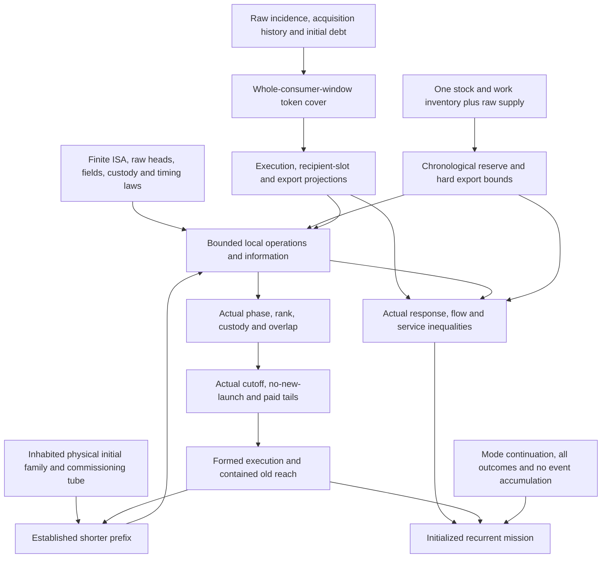

# Source class, comparison judgment and premise responsibility

Status: P0 design and baseline extraction. The raw class below is specified independently of a winning controller; its productive certificate subclass is still being constructed. No general recurrence theorem or second positive family is asserted here. [CONTRACT](CONTRACT.md) controls the required judgment. [PRIOR-ART](PRIOR-ART.md) distinguishes existing results from remaining construction.

## Judgment and representation boundary

A design datum d fixes a finite actor/role incidence, physical port and resource graph, raw instruction and operation alphabets, intervals for primitive laws and delays, an initial-state family, admissible causal fault histories, and the actual mission. The hidden member and fault trajectory are selected only after the policy family pi(d). Each intact actor's next action depends only on its own obtained observations, finite private state and permitted local timing. Faults can change execution, inputs, authority and physical exports through distinct declared projections. The analyst's fault cover is not a runtime input.

The conclusion sought is one local finite implementation preserving actual protected variables, quantitative delivered service and deadlines, the component-indexed factual response rule, actual resource/thermal viability and time-divergent maximal execution, together with useful return of released nonpersistent dependencies. Failed and blocked operations remain source outcomes. Return is relative to actual conforming consumers: old information can remain, and residue at a persistently failed consumer remains charged to that consumer's antecedent reach. This is neither erased adversary knowledge nor absolute revocation at arbitrary failed sinks.

The source representation deliberately omits fabrication detail below stipulated finite operations and constitutive laws. It does not omit pending operations, destinations, accumulated work, physical state, code/private state, local uncertainty or alternatives distinguishable by an allowed continuation. A source map is forward demonic behavior preservation plus a local-policy realization; a state projection or success-label map is insufficient. Negative transfers require source-admitted indistinguishability/counterexamples or their own reflection law. Changing actors, fault domains or event granularity requires explicit index maps and information preservation; the existing same-index Execution theorem cannot supply them silently.

## Raw class before certification

Consider finite open causal systems with finite-word programmable roles, bounded-degree or explicitly bounded-footprint typed relations, and finite-dimensional physical components. Separate observation, transport, execution/authority, maintenance, physical influence and resource incidence. Incidence may be hypergraphic and recipient dependent; one fault token can affect several slots, several destinations and an independent physical export. Each finite design fixes finite memory and resources for its entire unbounded execution. The scaling index adds actual protected/service units with their capacities, not unused replicas.

An admissible raw source supplies concrete transition/flow relations, including rejection, delay, partial completion, unavailable input and hostile outputs. Primitive clocks and material rates may have uncertainty; neither synchronized logical rounds nor a correct timestamp service is implicit. Initial states may contain charged faults and arbitrary inactive/raw state, but every later renewal must establish its own entry conditions. Raw acquisition/release events retain multiplicity, overlap, acquired knowledge and old causal reach. Raw local acquisition envelopes and persistent occupancy are independent source restrictions; they do not assert an effective clean fraction. Finite support envelopes, actual rate bounds and all-interval replenishment are permitted candidate primitives, subject to the assumption challenge below. Successful repair, accurate aggregate inference and effective access are not primitives.

For physical continuation, a source must expose its local mode equations/relations, event handling and state bounds. Local totality alone is not automatically a global nonblocking certificate: feedback, shared algebraic constraints, event accumulation and common resource competition must be checked. For resource composition, each stock and pending reservation has one physical identity and one accounting boundary; transfers cancel only across actually shared ports. The restricted phase/rank subclass under investigation uses finite, observable progress relations and bounded raw jobs, not an oracle choosing a successful repair path.

This raw class includes losing and uncertifiable members. For example, common-dependency reach may erase every relevant observation, all available interventions may conflict across indistinguishable states, resistance may exceed all available force, or reserve may be insufficient for recurring attempts. A constructor must return a specific failed certificate when it cannot justify its advertised output. Such failure does not prove universal source impossibility. The class is a research target, not yet a theorem that every member wins.

## Predeclared architectural and comparison axes

The selected first structural family is the explicitly completed primary port source A': forty-neighbor wiring, ordinary mutable private candidate words, two-bank custody and physical energy/tail retirement, with an explicit failed-gate flow/transition law. Nominal mechanisms retained unchanged require correspondence at their stated interfaces. The sampled predecessor/abort-cleanup releases in [GATE-SOURCE-COMPLETION](GATE-SOURCE-COMPLETION.md) are an explicit nominal-law change, with their own work, timing and mission-preservation obligations; exact nominal trace equivalence is not asserted. The frozen source A remains the reference and its files are preserved; its implication to the all-mode event interface is unestablished, as recorded in [BASELINE-EVENTS](BASELINE-EVENTS.md). No universal inclusion of all frozen-A failed histories in A' is claimed. The new failed-mode specification, its admissibility and every added state/work/delay are counted on both sides of a same-A'-source direct-versus-core comparison. A' must retain the full joint difficulty bundle, including genuinely failed physical fixtures and hostile outputs without useful return there. Its positive theorem must use the extracted core; importing PRIMARY-ASSEMBLY wholesale would not establish proof reduction. This visible route revision uses CONTRACT RP4's permitted first-family choice and preserves all mandatory completion gates.

The selected development candidate for the second family replaces ordinary private-candidate copying/full-image comparison by asynchronous fixed-address all-bit threshold writing, retaining two-bank continuity and one actual body per bank. The earlier single-bank route met a scan-phase obstruction; [VECTOR-REFRESH](VECTOR-REFRESH.md) and [THRESHOLD-PROGRAM](THRESHOLD-PROGRAM.md) retain the actual distinction. Finite body replacement and incarnation-scoped operations checked at fallible sinks remain reserve alternatives if the chosen supplier fails. Threshold writing must construct actual mutable-code execution, physical dwell, old-writer exclusion, pulse/reset/parent retirement and interval compatibility; it cannot assume ROM or a successful reset. These are development selections, not positive-family or repository-acceptance verdicts.

A candidate second family's spatial skeleton is an irregular bounded-degree graph of actual protected plant units, with bounded local renewal neighborhoods and consumed physical/resource coupling across units. Raw faults are constrained on the same overlapping neighborhoods, with no constant global cap. The intended scaling witnesses are recurring simultaneous positive-duration impairment in linearly many consumed neighborhoods and fixed-scale cross-neighborhood effects. Neighborhood size, work, observation fan-out and service normalization must be explicit. Neither a graph drawing nor independent copies joined by unused edges earns RP2 credit.

At least one mechanism comparison will fix the actual plant, initial uncertainty, service amount/deadline, factual response rule, raw resistance/acquisition opportunities, physical influence and replenishment/capacities. A changed internal reconstruction or observation mechanism then owes its new local suppliers and complete time/effect/work liabilities. If no two candidate mechanisms fit a single capacity envelope, report the changed context instead of calling that a matched comparison. Cross-family maps may change internal carriers and units but must preserve protected outcomes, response duties and quantitative service, not only a Boolean mission verdict.

## Baseline transitive premise graph

The following graph names obligations, not runtime services. The original source files remain authoritative for exact definitions and numbers. The dependency cuts are justified by their different consumers and falsifiers; a future merge is allowed only if it preserves those dependencies.

The Prefix–Jobs–Phase–New cycle is not licensed by graph edges. PRIMARY-ASSEMBLY closes it with initialized finite prefixes: at a first proposed aging failure, all consumed jobs finish strictly before the debt could become uncharged. A future generic proof must derive the corresponding bound from smaller ranks/operations. Simultaneous inequalities involving H and fault support require one joint arithmetic witness; algebraic consistency alone does not establish causal availability.

The baseline nodes expand as follows. Raw window containment is in RETURN/Return.lean and does not say that an aged-out role recovered. RECEIVER supplies token-based projections; two islands sharing a host name can corrupt different slots. PROGRAM, RECEIVER and LOCAL-INDEXING supply finite local action selection and actual paid input capture; the 3315-cell image is not replaced by an analyst's estimator. CONTINUITY gives whole-job ready-interval coverage, while GEOMETRY supplies its particular overlap and phase suppliers. CLAMP/OPERATIONS/GEOMETRY supply actual candidate ownership, first-motion stiction, writer exclusion, scans, rearm and phase progress. Phase 4 uses a real reset stroke; its watchdog is refreshed, so a generic timeout proof would be false.

PORT-SOURCE/PORT-RESOURCES supply energy and transit state, actual cut, a truthful low-E sample and the strict no-rearm margin. From F=E+T and F'<=rho-.1F, the old-power argument must retain both stores. A low E can subsequently rise; what persists is no new launch under the cut/rearm law. Already funded instruction, read, write and field tails plus fixed destinations remain separate. Persistent-site residue stays charged through its continuing recipient/export projections. Current C=P does not cancel an old pending write.

The resources node expands to one real inventory, price/rate bounds for arbitrary code and rejected traffic, all-interval supply deficits, chronological reservoir bounds, actual delivery at intact funding boundaries, hard bounds at failed boundaries, and energy/heat conservation across real ports. A zone capacity bound is not duplicated usable stock. PRIMARY-ASSEMBLY's nonblocking argument additionally checks local mode flow, finite event descendants, held-request causal order and retained failure outcomes; safe successful endpoints alone do not discharge it.

The plant node uses actual source row error, observation-to-effect age, rounding, retained RC dynamics, complete adverse flow and collar inequalities. Lost nominal output b and independent export Mp contribute b+Mp even when one token causes both. The frozen source's conditional H is10456118540795 quanta with raw rate1/104548602495950. The completed local A' gate construction adds one actual sampled predecessor/cleanup interface and proposes H10456118540836, an increment41 under the inherited itinerary; its six-token arithmetic is checked. Neither scalar closes the new full source-to-phase map. In particular, any revised interrupted-entry/all-emitter itinerary must be charged before claiming A' return. These are sufficient compatibility regions, not derived optima. The direct current proof combines all these nodes at PRIMARY-ASSEMBLY's initialized global argument. Written universal derivations, selected Lean lemmas, exact finite arithmetic and executed image probes remain distinct evidence levels.

## Dependencies of the portable arguments now in use

These are responsibility edges for the current G1–G3 exports. An open leaf is part of the proof burden. In particular the candidate raw class can contain a losing device. The mathematical sources below stipulate physical rate, observation, stiction, fault-footprint and supply laws. Empirical correspondence of a fabricated device would be an additional supplier; no fabrication claim is used here.

| Consumer | Source-independent result or import | Local, finite and unresolved suppliers |
| --- | --- | --- |
| G1, old authority or missing service | [Authority ancestry, actual cut and consumer-demand proof](CORE.md). Once each demanded job has an earlier-prefix decreasing step, `explainMiss` produces the stopped operation even on a run with no issue. Root and footprint tracing cover the retained liabilities. The [recent common-history lift](HISTORICAL-REPAIR-LIFT.md) composes validated changes of presentation on one actual joint cut. | Independent demand/start, legitimate refusal, local poll and effect deadline, each opcode's relevant reads and retained children, source cut/neutral formation, and a bounded repayment or valid reattribution to an actual raw occurrence. For A′ the frozen running-body scan, reply availability and parent/field tails remain material. For B the [common clock attachment](SOURCE-CLOCK-WIRING.md), [resident code cell](RESIDENT-CUSTODY.md) and [return/keeper comparison](ABORT-EMITTER-TURNOVER.md) discharge smaller seams. The full donor orbit, all permitted interruptions and initial physical overlays remain open. |
| G1 to G2, actual regional exposure | Whole-window incidence and finite union of actual host and port footprints. A shared incident can remove several useful roles and still energize a hostile export. The [spatial history](SPATIAL-HISTORY.md) gives a family of joint raw schedules with a conditional realized-load floor. | Every lost positive-weight contributor, including silence, requires a physical cause in the same consumer window. Every independent harmful signed flow has a gross portable-boundary cap at its actual port. Exact counts, union weights and cross-neighborhood coupling belong to the finite compatibility calculation. Payment, opportunity and impairment must coexist on the same history. |
| G2, recurrent protection and service | [Service fibres](SERVICE-FIBRES.md) applies exact safe-fibre and adaptive switching results to the physical RC tracker. The aggregate collar/initial-tube proof uses the actual losses and independent exports above, with distinct adverse margins for A′ and B. The factual cut duty uses its own evidence-to-effect interval. | Connected gain and sufficient **powered** duration, true held commands, age/error across every physical frame, allowed output weights, regional heat/coupling, no uncharged jump across a protected face, and correct conduct on each performed invasive action. A spent clock with no output and a standing harmful field with no CPU action use different source proofs. |
| G3, elapsed time, resources and nonblocking | [Flow/event composition](FLOW-COMPOSITION.md) supplies held-mode existence and finite-root concatenation. [Operating bank](OPERATING-FLOW-JOIN.md) instantiates a capped port roster with transfer, bleed and thermal effects. [Paced history transfer](PACED-HISTORY-TRANSFER.md) imports generated comparison, causal lifting and finite-past chronology, with a time-divergent held-cut source subcase. | One U/E/T, cap and thermal-zone inventory, signed interconnection and actual occupancy/arrival times. Every failed or held port needs a continuing bounded flow or a genuine enabled edge, including zero-energy waits and simultaneous events. Need positive real service opportunities, complete fault/event constructor coverage and an actual finite-horizon event bound over the full source. A finite causal past permits Zeno clocks by itself. |

The timing and service dependencies form a genuine cycle across consecutive prefixes. Start with a physical initial relation and an inhabited commissioning tube. On the established earlier prefix, G3's local progress, custody and reservoir laws justify the next bounded G1 job, including its last actual application. Retained deadlines must leave strict slack to the first alleged defect. G1 and the finite spatial calculation provide the omission and export bounds for G2 at that boundary. Continuous exits use the physical collar or interval comparison rather than a fictitious first discrete failure time. G2's protected region and the resource bounds then justify the next flow extension. A mere upper bound on events or spending does not preclude silence. A rank argument about physically unsupported future completions cannot close this cycle. The component demand/ownership checks and remaining common-history joins determine whether either concrete family meets the interface.

## Same-source obligation baseline and proposed factoring

For each target source, the direct route is allowed the same existing information, refinement, raw-window, chronological-resource and continuity results as the reusable route. It must still combine the new source's local mechanism into (G1) incident-to-effective-support/retirement closure, (G2) initialized recurrent safety/service, and (G3) common time/resource/nonblocking closure. The prospective reusable route pays one new global theorem and adapter interface, then supplies proper-scope local ranks, raw footprint maps, one-step plant bounds, finite compatibility and physical/implementation suppliers. No reduced burden is claimed until both positive families use G1–G3 unchanged.

Every adapter leaf will be classified as primitive assumption, existing import, local realization lemma, finite compatibility calculation, source-specific global argument, empirical supplier or unresolved obligation. Any adapter premise quantified over the whole assembled recurrent mission must remain global. Source-local universal transition laws are allowed when their dependency support is proper and their proof does not repeat G1–G3. The comparison includes new translation/checker realization and setup costs. Neither file count nor words are an aggregation scale for these heterogeneous obligations.

## Assumption admission and falsifiers

The inherited A01–A18 test applies before claiming a source admitted. Fixed raw incidence is a permitted candidate design input only when actual identity/alias changes are accounted; a shared calibrator or old destination reopens every reached projection. Bounded force/work and nominal rates are constitutive inputs, not evidence of actual service; removing a damping floor, adding an export path or exceeding resistance reopens progress and safety. Raw replenishment may recur through deficits, but a demand bound needs a complete inventory including rejected/hostile work. Initial characterized execution is allowed only at entry; reapplying it after a fault would assume renewal. Public mathematical P is not a protected runtime copy. Faultable consumers retain factual duties under input-only corruption. Raw fault rate/occupancy restrictions retain indefinite positive fresh incidents and old effects, rather than an assumed clean population.

For each terminal restriction, record its available design/measurement supplier, persistence or boundary, a nearby meaningful challenge, theorem validity under it, and program adequacy. The raw class above has not passed that full admission exercise merely by naming these duties. Conditional triggers remain those in CONTRACT: active probing, learning, cryptography/randomness, changing membership, live upgrades, wearing replacement and named-platform claims activate only if used. Finite constitutive repeatability is not empirical validation; an indefinitely wearing source would owe actual usable replenishment.

## Current disposition

Derived baseline dependency extraction; design candidate for the raw class and source completions. The source-grounded framing probe has a bounded checked disposition in [FRAMINGS](FRAMINGS.md); the common core remains a candidate pending complete source maps and positive instantiation. The closest literature supports shorter-prefix reasoning, exposure windows and recipient-relative retirement at explicit scopes, while leaving the faultable supplier problem intact. The active source decision is the minimal explicit A' completion rather than silently asserting the frozen-A failed-mode entailment. Prefer retained catch/rearm state, jams, held wrong outputs, rooted overrides and actual travel/consume laws; use a new rate-memory device only where needed and count its changed costs. [GATE-REALIZATION](GATE-REALIZATION.md) supplies one candidate kernel, not a compulsory replacement for every predicate. The integrated [gate-source completion](GATE-SOURCE-COMPLETION.md) supplies held-plane failures, rigid jam/attachment rules, actual-zero/POWER entry, two nonstoring actuator ports consuming the same existing E, and a coherent physical sampler with bounded work and event rate. Its actual14,930,944 control bits and29,862,912 added burst are paid in the stated old-style owner inventory. The sampler retains old levels on underfunding and its clock stops at empty U; a sampled low-E value remains historical, requiring the retained trip/no-rearm/cut implication rather than being called current E<Eoff. Its fixed B80 counts/addresses do not instantiate threshold B. The decisive next checks are correspondence for retained nominal mechanisms, validity of the changed sampled releases, complete failed-mode/forced-boundary and physical inventory coverage, full source admission and unchanged reuse of G1–G3 in A' and the threshold family. No positive gate is discharged by this route selection.

The frozen baseline aggregate was reproduced with `local-control/verify.py --check` from an archive of `fb85a7606f45e52d0cd48e023ab9776dd526640c`, keeping its original 321-file binding and all retained manifests unchanged. Its strict proof checks and executable records matched. This re-establishes the historical evidence at its own scope; the new portability artifacts are outside that old aggregate and cannot inherit its completion verdict. The three primary source/resource/comparison records were also reproduced independently by a read-only reviewer.
